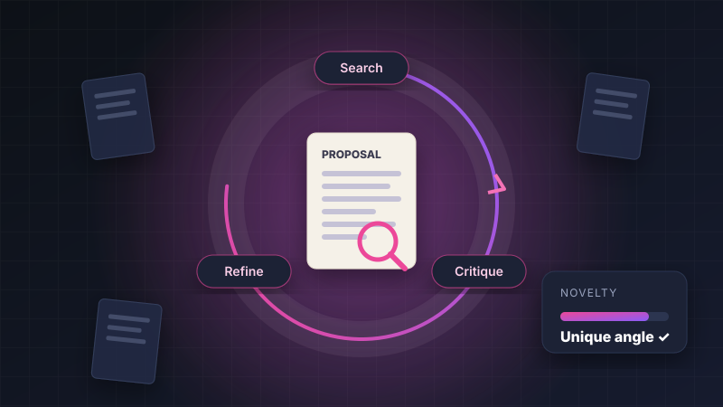
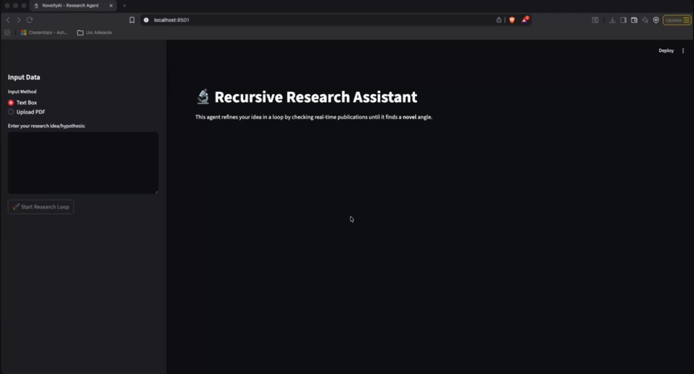

<!-- portfolio:start -->
<div align="center">



# NoveltyAI Research Assistant

**Recursive loop that refines research ideas until they are novel**

 [](https://ashween.space/projects/novelty-ai)

</div>

## About

Scans live literature, flags overlaps with existing work, and iteratively rewrites a proposal until it finds a unique research angle. Powered by a local Large Language Model (Llama 3.1).

Developed NoveltyAI, a Streamlit-based recursive research assistant that helps researchers turn initial concepts into publication-ready proposals through an automated, iterative loop.

Integrated local Large Language Models (LLMs) through Ollama, using Llama 3.1 to evaluate research novelty, detect conflicts with existing literature, and refine proposals until a unique research angle emerges.

Implemented an automated literature-scanning pipeline with the DuckDuckGo Search API that runs targeted academic queries, giving the model real-time context to check the originality of typed ideas or uploaded PDF concept papers.

| | |
|---|---|
| **Project** | NoveltyAI: Recursive Research Assistant via LLM |
| **Project type** | Local LLM Application |

## Demo

<p align="center"><a href="https://www.youtube.com/watch?v=u8psxDch-IY"></a><br/><sub>▶ NoveltyAI demo (YouTube)</sub></p>

## Tech stack

`Python` · `Streamlit` · `Ollama` · `Llama 3.1` · `DuckDuckGo Search API`

> Full write-up on the portfolio: **[ashween.space/projects/novelty-ai](https://ashween.space/projects/novelty-ai)**

<!-- portfolio:end -->

---

## Overview

NoveltyAI is a **Streamlit-based recursive research assistant** designed
to help researchers transform initial concepts into publication-ready
proposals.

The system operates in an iterative research loop where it:

-   Generates academic search queries\
-   Scans literature via DuckDuckGo\
-   Evaluates novelty\
-   Detects conflicts with existing research\
-   Automatically refines the proposal\
-   Repeats until a unique angle is identified or loop limit is reached

## 📌 Features

-   Recursive refinement loop\
-   Automated literature scanning\
-   LLM-powered rewriting via Ollama\
-   PDF concept processing\
-   Real-time research status tracking\
-   Markdown proposal generation\
-   Full refinement history logging

------------------------------------------------------------------------

## 🛠️ Prerequisites

-   Python 3.x\
-   Ollama (installed and running locally)\
-   Virtual environment (recommended)

------------------------------------------------------------------------

## ⚙️ Setup Instructions

### 1. Clone Repository & Setup Environment

``` bash
git clone <your-repo-url>.git
cd <your-repo-folder>

python -m venv .venv

# Windows
.venv\Scripts\activate

# macOS / Linux
source .venv/bin/activate
```

### 2. Install Dependencies

``` bash
pip install -r requirements.txt
```

### 3. Configuration

Create a `.env` file in the project root:

    LLM_PROVIDER=ollama
    OLLAMA_BASE_URL=http://localhost:11434
    OLLAMA_MODEL=llama3.1:8b
    MAX_REFINEMENT_LOOPS=5
    SEARCH_RESULTS_PER_ITERATION=5
    SIMILARITY_THRESHOLD=0.85

------------------------------------------------------------------------

## ▶️ Running the Application

Ensure Ollama is running:

``` bash
ollama serve
```

Launch Streamlit:

``` bash
streamlit run streamlit_app.py
```

Open: http://localhost:8501

------------------------------------------------------------------------

## 🧑‍🔬 User Guide

### Inputting Research Ideas

-   Use text box to enter hypothesis\
-   Or upload PDF for automatic extraction

### Start Research Loop

Click **Start Research Loop** to begin iterative novelty refinement.

### Final Output

-   Title\
-   Abstract\
-   Methodology\
-   Expected Contribution\
-   Full refinement history

------------------------------------------------------------------------

## Demo Video

Watch the demo of the application:

[](https://youtu.be/u8psxDch-IY)

------------------------------------------------------------------------

## 🛠️ Troubleshooting

### Ollama Connection Issues

-   Ensure service is running\
-   Verify OLLAMA_BASE_URL\
-   Run: `ollama pull llama3.1:8b`

### Search Failures

-   Check internet connection\
-   Reduce SEARCH_RESULTS_PER_ITERATION

### No Novelty Found

-   Increase MAX_REFINEMENT_LOOPS\
-   Adjust SIMILARITY_THRESHOLD

------------------------------------------------------------------------

Developed by Ashween R
